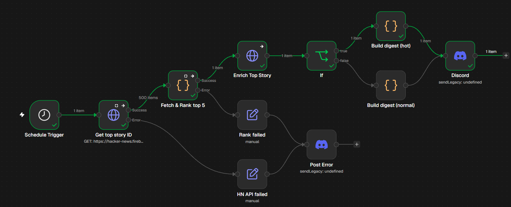
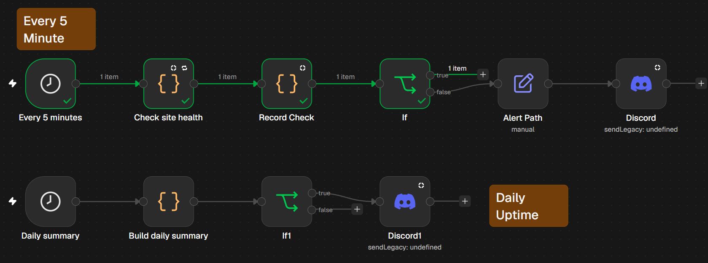

# Automation & QA Developer: Take-Home Assessment

**Author:** Soumil Shamak  
**Repository:** Task 1 QA report, Task 2 HN morning brief, and bonus uptime monitor (n8n).

---

## Repository contents

| File | Purpose |
|------|---------|
| `Task1_QA_Report_SoumilShamak.pdf` | Task 1 bug table and root-cause analysis |
| `Task2_Workflow_SoumilShamak.json` | Task 2: Hacker News digest workflow |
| `workflow.png` | Task 2 workflow canvas screenshot |
| `Bonus_UptimeMonitor_SoumilShamak.json` | Bonus: Conduit uptime monitor workflow |
| `uptime_workflow.png` | Bonus workflow canvas screenshot |
| `docker-compose.yml` | Local n8n via Docker Desktop |
| `README.md` | This document |

---

## Task 1: Web app QA (summary)

- **Application:** [Conduit / RealWorld](https://demo.realworld.show/) (Angular demo).
- **Scope:** Sign-up, login, CRUD articles, settings, feeds, favorites, logout, plus edge cases.
- **Deliverable:** `Task1_QA_Report_SoumilShamak.pdf` (10 issues, root-cause on delete-without-confirmation).
- **Details:** See the PDF.

---

## Task 2: Hacker News morning brief

### Purpose

Hourly pull from Hacker News: top five stories by score, enrich the lead story with the author user API, branch when score > 100, post digest to **Discord** (webhook credential). Errors on fetch/rank go to **Post Error** on the same channel.

### Flow

```
Schedule (every 1h)
  -> GET topstories.json
       success -> Fetch & Rank top 5 -> GET user/{author} -> IF (score > 100)
                    true  -> Build digest (hot)  --\
                    false -> Build digest (normal) ---+-> Discord
       error -> HN API failed -> Post Error
       Rank error -> Rank failed -> Post Error
```



### APIs

| Step | Endpoint |
|------|----------|
| Story IDs | `GET https://hacker-news.firebaseio.com/v0/topstories.json` |
| Stories | `GET https://hacker-news.firebaseio.com/v0/item/{id}.json` (up to 30 in Code) |
| Enrich | `GET https://hacker-news.firebaseio.com/v0/user/{username}.json` |

No API keys. Chosen for a simple, JSON-first developer brief.

### Logic

1. Normalize `topstories` (single array or one ID per item).
2. Fetch items, keep `type === 'story'`, sort by score, take top 5.
3. IF `topStory.score` > 100: hotter vs normal digest text.
4. Discord message from `{{ $json.content }}`.

### Credentials

Discord webhook stored as **Discord Webhook account**. Exports reference credential IDs only. Re-link after import.

---

## Bonus: Uptime monitor (`demo.realworld.show`)

### Purpose

Same Task 1 app URL, same Discord webhook as Task 2: probe every **5 minutes**, **retry up to 3 times** (2s pause), record **response time**, alert when unhealthy, and send a **rolling 24h summary** on a daily schedule.

### Flow

```
Every 5 minutes -> Check site health -> Record check -> IF ok?
                        true  -> (no message)
                        false -> Format alert -> Discord alert

Daily summary -> Build daily summary -> IF hasData? -> Discord summary
```



### Health check

- `GET https://demo.realworld.show/` with `returnFullResponse: true`.
- **OK** when status is 200 **and** body contains `conduit` or `realworld` (SPA routes can still return 200; status alone is not enough).
- Each run appends to **workflow static data** via `Record check` (`...check` passed through so `ok` reaches the IF).
- Failed checks after retries: Discord alert with time, status, ms, attempts, URL.

### Daily summary

Reads checks from static data for the **last 24 hours**: count, failures, uptime %, average response time. `hasData` is true when at least one check exists in the window.

**Note:** Static data is saved on **full workflow runs** (Test workflow / active schedule), not only single-node Execute step.

### Test ideas

| Case | Expect |
|------|--------|
| Homepage | `ok: true`, no alert |
| Bad host (e.g. invalid domain) | `ok: false`, Discord alert |
| Daily after 2+ five-minute runs | Summary with checks > 0 |

---

## Run n8n locally

**Prerequisites:** Docker Desktop.

```powershell
cd C:\Users\HP\Downloads\AssessmentTask
docker compose up -d
```

Open **http://localhost:5678**, then:

1. Import `Task2_Workflow_SoumilShamak.json` and `Bonus_UptimeMonitor_SoumilShamak.json`.
2. Create/select **Discord Webhook** credential (one webhook is fine for both workflows).
3. Attach credential on all Discord nodes in both workflows.
4. Test each workflow, then set **Active** for the schedules you want.

```powershell
docker compose down
```

Data persists in the `n8n_data` volume. Timezone: `Asia/Kolkata` in `docker-compose.yml`.

---
